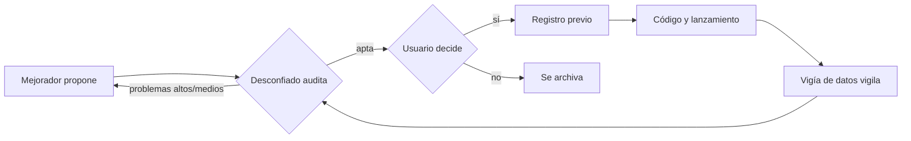

# Agentes del proyecto

Índice: [[00 Inicio]] · Organización: [[Gerencia y mesa directiva]] · Ver también [[Guía de uso#4. Proponer una mejora a los modelos]] · [[Automatizaciones]]

Asistentes especializados de Claude con instrucciones propias, guardadas en `.claude/agents/`. Se invocan pidiéndoselo a Claude ("que el desconfiado revise…").

## Desconfiado
- **Rol:** auditor escéptico. Asume que hay un error hasta que la evidencia muestre lo contrario. No escribe código del proyecto.
- **Revisa:** fuga de información, contaminación del modelo, datos, holdouts, pruebas múltiples, muestras dependientes, potencia, costos, robustez y reproducibilidad.
- **Responde:** APROBADO / RECHAZADO / DUDAS ABIERTAS, con lo que verificó, los problemas por gravedad, las ejecuciones que pide y lo que no pudo verificar.
- **Programado:** participa como Jefe de Auditoría en la reunión diaria de las 6:57 a. m. ([[Gerencia y mesa directiva]]).
- Archivo: `.claude/agents/desconfiado.md`

## Mejorador
- **Rol:** aprende de los resultados y propone mejoras como **variantes nuevas** pre-registradas.
- **Regla de fondo:** no se descarta un modelo. Si uno rinde peor, propone cómo ajustarlo.
- **Guía de trabajo:** diagnóstico → elegir 1 o 2 ajustes de un menú → confirmar solo con datos nuevos → propuesta con plantilla → ciclo con el desconfiado → resumen al usuario.
- Archivo: `.claude/agents/mejorador.md` · Propuestas: `docs/propuestas/`

## Vigía de datos
- **Rol:** revisa los datos recogidos (huecos, duplicados, valores raros, coherencia del resumen, hashes) y el estado de los workflows.
- **Puede actuar** solo en lo operativo: relanzar KT-002 si está parado o pedir *rerun* de tareas fallidas. Nunca edita datos ni cancela corridas.
- Archivo: `.claude/agents/vigia-datos.md`

## Flujo de una mejora

## Agentes anteriores
- `strategy-reviewer`: revisión de overfitting en la estrategia EMA/ATR de XAUUSD.
- `infra-guardian`: ejecuta cambios confirmados en Task Scheduler y procesos de la PC.
