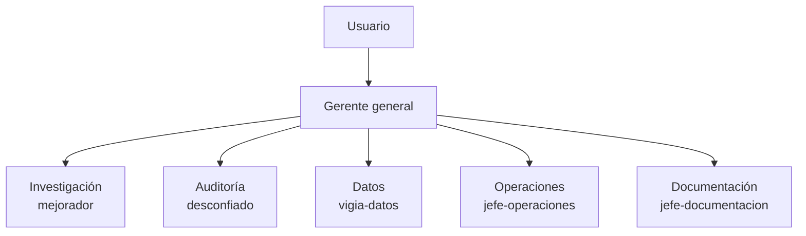

# Gerencia y mesa directiva

Índice: [[00 Inicio]] · Ver también [[Agentes del proyecto]] · [[Automatizaciones]]

Desde el 2026-10-20 el proyecto tiene un **gerente general** que decide el día a día y dirige a los jefes de área, para que el usuario no tenga que contestar todo.

## Jerarquía

Cada nivel rinde cuentas al de arriba con evidencia; el de arriba pide explicaciones, corrige y registra llamados de atención. Los jefes pueden tener subordinados con la misma regla.

## Qué decide el gerente solo
Lo operativo, el reparto de trabajo y las mediciones nuevas **sin dinero** que el desconfiado haya aprobado. Esta última el usuario se la delegó el 2026-10-20.

## Cuándo pregunta al usuario
Solo si hay dinero real, holdouts sellados, datos que habría que borrar o reescribir, cambios a un experimento en curso, cambios de reglas, un veto del desconfiado en disputa o un colapso que no se arregló en 2 intentos.

## Independencia del auditor
El desconfiado puede ser corregido por cómo trabaja, pero nadie le baja la vara ni lo hace aprobar.

## Reunión diaria
Todos los días a las 6:57 a. m. (Costa Rica). El acta queda en la carpeta `Reuniones/` y al usuario le llega un resumen de hasta 8 líneas. Orden del día y detalles en `docs/gerencia/REUNION_DIARIA.md`.

## Archivos
- Estructura y reglas: `docs/gerencia/ESTRUCTURA.md`
- Decisiones: `docs/gerencia/decisiones.md` · Desempeño: `docs/gerencia/desempeno.md`
- Agentes: `.claude/agents/gerente.md`, `jefe-operaciones.md`, `jefe-documentacion.md` (más `mejorador`, `desconfiado`, `vigia-datos`)
