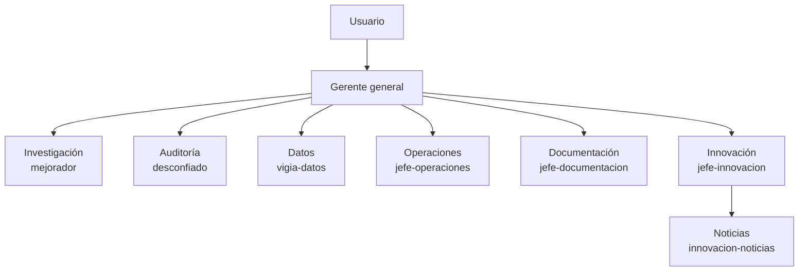

# Gerencia y mesa directiva

Índice: [[00 Inicio]] · Ver también [[Agentes del proyecto]] · [[Automatizaciones]]

Desde el 2026-10-20 el proyecto tiene un **gerente general** que decide el día a día y dirige a los jefes de área, para que el usuario no tenga que contestar todo.

## Jerarquía

**Innovación** (desde 2026-10-20): busca skills, repos, agentes, plugins, conectores e ideas; detecta conectores que fallan; su subordinado vigila noticias que pueden afectar las predicciones. Solo propone: decide el gerente, y lo que toque modelos pasa por el mejorador y el desconfiado. No instala ni paga nada. Revisa los lunes.
Cada nivel rinde cuentas al de arriba con evidencia; el de arriba pide explicaciones, corrige y registra llamados de atención. Los jefes pueden tener subordinados con la misma regla.

## Qué decide el gerente solo
Lo operativo, el reparto de trabajo y las mediciones nuevas **sin dinero** que el desconfiado haya aprobado. Esta última el usuario se la delegó el 2026-10-20.

## Cuándo pregunta al usuario
Solo si hay dinero real, holdouts sellados, datos que habría que borrar o reescribir, cambios a un experimento en curso, cambios de reglas, un veto del desconfiado en disputa o un colapso que no se arregló en 2 intentos.

## Independencia del auditor
El desconfiado puede ser corregido por cómo trabaja, pero nadie le baja la vara ni lo hace aprobar.

## Informe diario (modo ahorro)
No hay reunión. Todos los jefes le reportan al gerente y él le rinde cuentas al usuario. Cada día a las 6:52 a. m. (Costa Rica) el gerente revisa todo con comandos directos, convoca a un jefe **solo si hace falta** y manda un mensaje de **máximo 5 líneas**. Detalles en `docs/gerencia/INFORME_DIARIO.md`.

Para ahorrar uso del plan: una sola tarea programada por día, el desconfiado revisa los datos de rutina solo una vez por semana (además de cada propuesta o resultado nuevo), y los jefes operativos usan un modelo más económico.

## Oficina del dueño
[Oficina del dueño](https://claude.ai/artifact/CJjo7mMyMEdyvTKbLc3wJc): página en la app de Claude para ver cómo va todo, dar órdenes al gerente o a un jefe, llamar al gerente en el momento, aprobar o rechazar lo que escala, preguntarle algo y ver sus decisiones. El gerente lee las órdenes cada mañana (o al llamarlo) y responde en la misma página.

## Archivos
- Estructura y reglas: `docs/gerencia/ESTRUCTURA.md`
- Decisiones: `docs/gerencia/decisiones.md` · Desempeño: `docs/gerencia/desempeno.md`
- Agentes: `.claude/agents/gerente.md`, `jefe-operaciones.md`, `jefe-documentacion.md`, `jefe-innovacion.md`, `innovacion-noticias.md` (más `mejorador`, `desconfiado`, `vigia-datos`)
